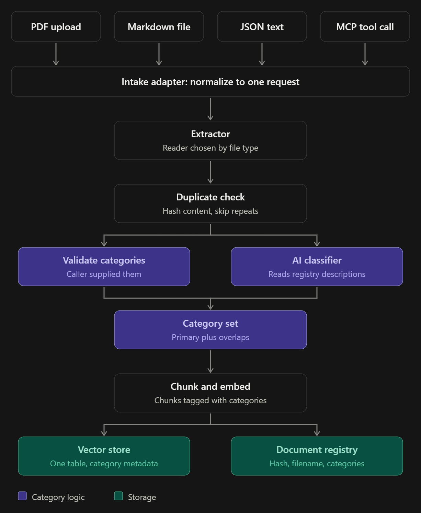

# Generic knowledge base

A Spring Boot 4.1 / Spring AI 2.0 service that ingests documents (PDF, Markdown, JSON, plain text), categorizes
them, stores chunk embeddings in Postgres with pgvector, and serves search and grounded question answering over
REST and MCP. Access is controlled by Keycloak-issued JWTs with three roles: `kb-reader` ⊂ `kb-editor` ⊂ `kb-admin`.

- **Ingestion:** extract → duplicate check (normalized-text SHA-256) → categorize (caller-supplied or AI) → chunk
  → embed and store
- **Retrieval:** the caller chooses per request: semantic, keyword or hybrid (RRF); query rewrite, multi-query or
  HyDE; LLM, Cohere or cross-encoder reranking; MMR. The default is plain semantic search.
- **Answers:** `/api/ask` answers only from retrieved passages, with `[n]` citations; with no relevant passages, the
  model isn't called.
- **MCP:** tools `search_knowledge_base`, `ask_knowledge_base`, `list_retrieval_options`, `list_categories`,
  `ingest_document` over HTTP/SSE.
- **Evaluation:** hit@k, recall@k, MRR and latency per configuration, compared with a baseline.

## Quick start

Requires Docker, a JDK, and an `OPENROUTER_API_KEY` (used for both chat and embeddings).

```bash
docker compose up -d        # Postgres + pgvector (5433), Keycloak (8180)
./mvnw spring-boot:run -Dspring-boot.run.arguments=--server.port=8091
```

`server.port` in `application.properties` is 9000. On the development machine that port is taken by Docker, so the
app runs on 8091, which is also what the frontend's dev proxy expects.

Get a token for a **dev-only** user (`alice` = reader, `bob` = editor, `carol` = admin; the password equals the
username) and search:

```bash
TOKEN=$(curl -s -d grant_type=password -d client_id=generic-cli -d username=alice -d password=alice \
  http://localhost:8180/realms/generic/protocol/openid-connect/token | jq -r .access_token)
curl -sG -H "Authorization: Bearer $TOKEN" http://localhost:8091/api/search \
  --data-urlencode "q=how many days off do I get" -d mode=hybrid
```

Run the tests (Docker required): `./mvnw test`.

## Documentation

| Document | Contents |
|---|---|
| [docs/ARCHITECTURE.md](docs/ARCHITECTURE.md) | What was built and why: code map, request flows, the retrieval toolkit, data model, libraries, configuration, design decisions, running and testing, honest status, glossary |
| [docs/USERS_AND_SECURITY.md](docs/USERS_AND_SECURITY.md) | Keycloak and JWT model, roles, creating users, getting tokens, MCP connection, production checklist |
| [docs/REVIEW_GUIDE.md](docs/REVIEW_GUIDE.md) | Reading order, review checklist, riskiest parts |
| [docs/api.md](docs/api.md) | Endpoint and MCP tool reference |

## Known issues (details in REVIEW_GUIDE.md)

- **`GET /api/chat`** (a demo endpoint) is reachable by any authenticated user, even without a `kb-*` role, and
  forwards text to the paid model.
- **AI DEBUG logging** writes prompts, including document text, to the log.
- **No rate limiting.**
- **The evaluation sample set is too easy** to choose between retrieval techniques, and the live evaluation run is
  incomplete.
