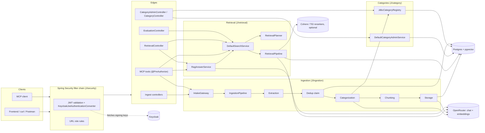
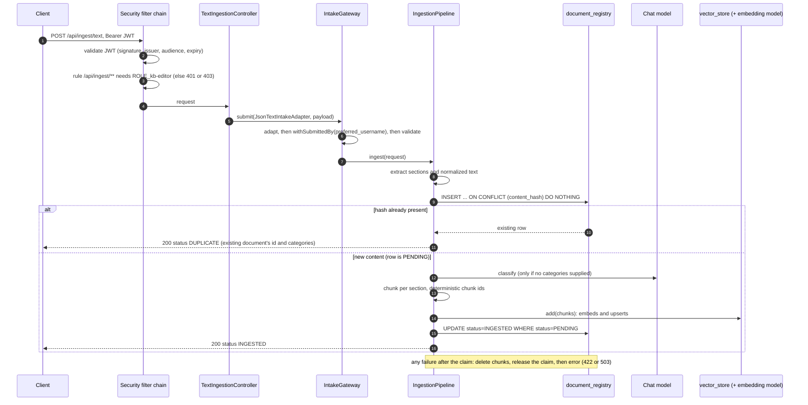
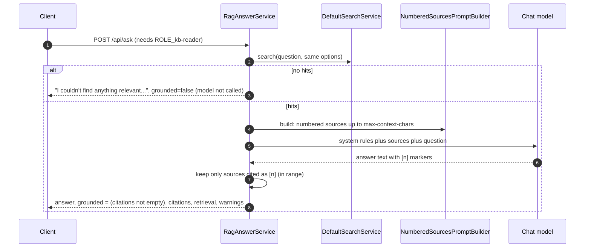
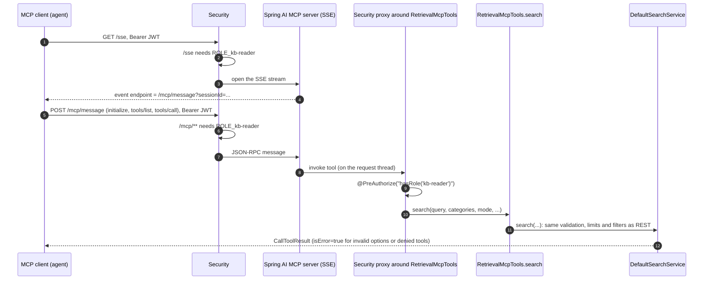
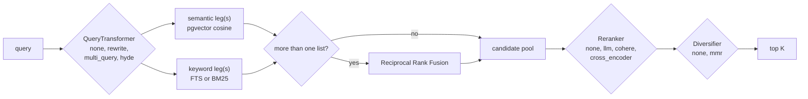

# Architecture

This document explains what the system does, how it works, and why it is built this way. It is written for
review, so every factual claim points at the file that proves it.

**Path shorthand used throughout**

| Prefix | Means |
|---|---|
| `J/` | `src/main/java/com/shk/generic/` |
| `T/` | `src/test/java/com/shk/generic/` |
| `R/` | `src/main/resources/` |

Statements that could not be checked against code, config or a test run are marked **unverified**.

Companion documents: [USERS_AND_SECURITY.md](USERS_AND_SECURITY.md) (authentication, users, roles),
[REVIEW_GUIDE.md](REVIEW_GUIDE.md) (reading order and checklist), [api.md](api.md) (endpoint reference).

---

## Java and Spring in five minutes (for Python readers)

These ideas appear on every page. Each is explained once here.

| Concept | What it is | Python analogy |
|---|---|---|
| **Bean** | An object that Spring creates and manages: one shared instance per class by default. Classes marked `@Component`, `@Service`, `@Repository` or `@RestController`, or returned from a `@Bean` method, become beans. | A module-level singleton that a framework builds for you. |
| **Dependency injection** | Beans declare what they need as constructor parameters; Spring passes the matching beans in. No class calls `new` on its collaborators. | FastAPI `Depends(...)`, but resolved once at startup. |
| **Interface** | A contract with no implementation. Most components here are an interface plus one or more implementations, so they can be swapped. | `typing.Protocol` or an `abc.ABC`. |
| **`List<SomeInterface>` injection** | Spring injects *every* bean implementing the interface. This is how the strategy registries discover all rerankers, extractors and so on. | A plugin registry built from entry points. |
| **`record`** | An immutable data class with a constructor, getters, `equals` and `hashCode`. | `@dataclass(frozen=True)`. |
| **`sealed interface`** | An interface whose implementations are a closed, known set. | `Union[A, B]`. |
| **`@ConfigurationProperties("prefix")`** | Binds `prefix.*` settings from `application.properties` or environment variables into a typed record, with defaults in `@DefaultValue`. Enabled by `@ConfigurationPropertiesScan` (`J/GenericApplication.java`). | `pydantic-settings` `BaseSettings`. |
| **`@RestController`** | An HTTP endpoint class. `@GetMapping("/x")` maps a method to a route. | A FastAPI router. |
| **`@RestControllerAdvice` + `@ExceptionHandler`** | Global mapping from exception type to HTTP response. | FastAPI `@app.exception_handler`. |
| **Servlet filter / `SecurityFilterChain`** | Code that runs before every request reaches a controller; Spring Security is a chain of these. | ASGI middleware. |
| **`@PreAuthorize("hasRole('x')")`** | Checked before a method runs. Spring wraps the bean in a *proxy* (a generated subclass) that performs the check, then calls the real method. | A decorator that raises `403` before calling the function. |
| **OAuth2 resource server** | An API that accepts `Authorization: Bearer <JWT>` and validates the token itself (signature, issuer, audience, expiry) using the identity provider's public keys. It never sees passwords. | `fastapi` + `python-jose` verifying a JWT against a JWKS URL. |
| **Flyway migration** | Versioned SQL files (`V1__…sql`, `V2__…sql`) applied in order at startup and recorded in a history table. | Alembic. |
| **Testcontainers** | Starts real Docker containers (Postgres, Keycloak) for tests. | `pytest` fixtures using `testcontainers-python`. |
| **`JdbcClient`** | Thin SQL helper with named parameters (`:name`). | SQLAlchemy Core or psycopg with named parameters. |
| **Lombok `@Slf4j`** | Generates a `log` field at compile time. | `log = logging.getLogger(__name__)`. |
| **Maven (`./mvnw`)** | Build and dependency tool; `pom.xml` lists dependencies. | `pip` + `pyproject.toml`, plus a task runner. |

---

## A. Overview

### What it is

A Spring Boot service that turns documents into a searchable knowledge base and answers questions from it.
Documents go in through REST or MCP; they are extracted, de-duplicated, categorized, chunked, embedded and
stored in Postgres with pgvector. Callers then search (several retrieval techniques, chosen per request) or
ask questions that are answered only from retrieved passages, with citations.

### Who uses it

| User | Through | Role (see USERS_AND_SECURITY.md) |
|---|---|---|
| People or apps searching and asking | REST (`/api/search`, `/api/ask`), the frontend | `kb-reader` |
| People or tools adding documents | REST (`/api/ingest/*`), MCP `ingest_document` | `kb-editor` |
| LLM agents (Claude Desktop, IDE agents) | MCP tools over `/sse` | `kb-reader`; `kb-editor` to ingest |
| Administrators | `/api/admin/categories`, `/api/admin/evaluation` | `kb-admin` |

A separate React frontend in `C:\Project\assesmentFE` (outside this repository) talks to this backend through
its Vite dev-server proxy. Its `.env` sets `BACKEND_URL=http://localhost:8091`.

### Features

| Feature | Entry points | Main code |
|---|---|---|
| Ingestion of PDF, Markdown, JSON and plain text | `POST /api/ingest/file`, `POST /api/ingest/text`, MCP `ingest_document` | `J/ingestion/pipeline/IngestionPipeline.java` |
| Duplicate detection (same normalized text = same document, also under concurrency) | inside ingestion | `J/ingestion/dedup/RegistryDuplicateGuard.java`, `J/ingestion/registry/JdbcDocumentRegistry.java#claim` |
| Categories: caller-supplied (validated) or AI-classified (guarded) | inside ingestion | `J/ingestion/category/DefaultCategorizationStage.java` |
| Category admin (create, update, deactivate, delete if unused) | `/api/admin/categories` | `J/category/admin/DefaultCategoryAdminService.java` |
| Search with selectable techniques | `GET /api/search`, MCP `search_knowledge_base` | `J/retrieval/pipeline/RetrievalPipeline.java` |
| Grounded answers with citations | `POST /api/ask`, MCP `ask_knowledge_base` | `J/retrieval/answer/RagAnswerService.java` |
| Options catalogue | `GET /api/search/modes`, MCP `list_retrieval_options` | `J/retrieval/options/RetrievalCatalog.java` |
| MCP server (5 tools) | `/sse` + `/mcp/message` | `J/retrieval/mcp/RetrievalMcpTools.java`, `J/ingestion/intake/mcp/IngestionMcpTools.java` |
| Security (Keycloak JWT, three roles, per-tool checks) | every endpoint | `J/security/SecurityConfiguration.java` |
| Retrieval evaluation (hit@k, recall@k, MRR, latency vs baseline) | `POST /api/admin/evaluation` | `J/retrieval/eval/EvaluationService.java` |

There is also a leftover demo endpoint, `GET /api/chat` (`J/demo/ChatController.java`). It sends the raw query to
the chat model. It is reachable by **any authenticated user, including one with no `kb-*` role**: see
[REVIEW_GUIDE.md](REVIEW_GUIDE.md), finding 1.

---

## B. Architecture and code map

### Component diagram



### Layering

| Layer | What it does | Examples |
|---|---|---|
| Security | Authenticates every request and applies URL role rules | `J/security/SecurityConfiguration.java` |
| Edges (controllers, MCP tools) | Translate HTTP or MCP input into a domain call; no business logic | `J/retrieval/web/RetrievalController.java`, `J/retrieval/mcp/RetrievalMcpTools.java` |
| Application services | One entry point per use case; validation | `IntakeGateway`, `DefaultSearchService`, `RagAnswerService`, `DefaultCategoryAdminService` |
| Pipelines (orchestrators) | Know the stage order, and nothing else | `IngestionPipeline`, `RetrievalPipeline` |
| Stages and strategies | One interface per step, one class per technique | `ChunkSearcher`, `KeywordEngine`, `Reranker`, `Diversifier`, `QueryTransformer` |
| Persistence | SQL against Postgres | `JdbcDocumentRegistry`, `JdbcCategoryRegistry`, `JdbcCategoryStore`, Spring AI `PgVectorStore` |

### Package map

`J/category/`: categories shared by ingestion, retrieval and admin.

| Class | Purpose |
|---|---|
| `CategoryRegistry` / `JdbcCategoryRegistry` | Read-only, cached view of the `category` table; cache dropped on `CategoryChangedEvent` (`onCategoryChanged`). |
| `admin/DefaultCategoryAdminService` | Create, update and delete rules; asks every `ProtectedCategoryPolicy` before deactivating or deleting; publishes `CategoryChangedEvent`. |
| `admin/CategoryUsage`, `admin/ProtectedCategoryPolicy` | Ports (interfaces) implemented by ingestion, so this package doesn't depend on ingestion internals. |
| `web/CategoryAdminController` | `/api/admin/categories` CRUD. |
| `web/CategoryController` | Public `GET /api/categories` (active categories). |
| `web/CategoryExceptionHandler` | Maps category exceptions to 400, 404 and 409. |

`J/ingestion/`: the write path.

| Class | Purpose |
|---|---|
| `intake/IntakeGateway` | The single path every transport uses: adapt → stamp submitter → validate → ingest. |
| `intake/{multipart,text,mcp}/*IntakeAdapter` | One adapter per transport; turns raw input into an `IngestionRequest`. |
| `intake/DefaultFormatDetector` | Detection order: declared format → `%PDF-` magic bytes → file extension → content-type → content sniffing. |
| `intake/DefaultIntakeValidator` | Rejects unknown, disallowed, empty or oversized input. |
| `pipeline/IngestionPipeline` | Stage order: extract → dedup claim → categorize → chunk → store; releases the claim on failure. |
| `extract/DefaultExtractionStage` + `extract/reader/*` | PDF (one section per page), Markdown (per heading), JSON (flattened `path: value` lines), text. |
| `dedup/RegistryDuplicateGuard` + `Sha256ContentHasher` | SHA-256 of normalized text; atomic check-and-claim. |
| `registry/JdbcDocumentRegistry` | `document_registry` table: claim, mark ingested, release, find stale. |
| `category/DefaultCategorizationStage` | Caller categories go to `SuppliedCategoryResolver`; none supplied goes to `AiCategoryClassifier`. |
| `category/classifier/ClassificationGuard` | Turns untrusted model output into a valid category set. |
| `chunk/DefaultChunkingStage` | Token chunks per section, deterministic ids, category metadata, embedding formatter. |
| `store/DefaultStorageStage` | Write chunks (this embeds them), then flip the registry row to `INGESTED`; deletes chunks on failure. |
| `store/StalePendingSweeper` | Scheduled cleanup of claims left `PENDING` by crashes. |

`J/retrieval/`: the read path.

| Class | Purpose |
|---|---|
| `web/RetrievalController` | `GET /api/search`, `GET /api/search/modes`, `POST /api/ask`. |
| `search/DefaultSearchService` | Validates the query and categories, plans, builds the filter, runs the pipeline. |
| `options/RetrievalPlanner` | Fills defaults, enforces limits, checks reranker availability and the LLM budget up front. |
| `pipeline/RetrievalPipeline` | transform → legs (parallel) → RRF → rerank → MMR → top K; builds `applied`, `warnings`, `explain`. |
| `search/VectorStoreChunkSearcher` | Semantic leg (implements the `ChunkSearcher` interface). |
| `keyword/PostgresFullTextEngine`, `keyword/ParadeDbBm25Engine` | Keyword leg implementations; `ActiveKeywordEngine` picks and verifies one. |
| `fusion/ReciprocalRankFusion` | RRF. |
| `rerank/*Reranker`, `RerankerRegistry` | none, LLM, Cohere, cross-encoder. |
| `diversify/MmrDiversifier` | MMR using stored embeddings (`JdbcChunkSimilarity`). |
| `transform/*QueryTransformer` | none, rewrite, multi-query, HyDE. |
| `llm/LlmCallExecutor`, `LlmCallBudget` | Per-call timeout and per-request call cap for LLM-backed stages. |
| `filter/CompositeSearchFilterFactory` | Builds one metadata filter from all `SearchFilterContributor` beans. |
| `answer/RagAnswerService` | Search → numbered-sources prompt → answer → keep cited sources. |
| `eval/*` | Golden set, metrics, runner, admin endpoint. |
| `mcp/RetrievalMcpTools` | MCP tools `search_knowledge_base`, `ask_knowledge_base`, `list_retrieval_options`, `list_categories`. |

`J/security/`

| Class | Purpose |
|---|---|
| `SecurityConfiguration` | URL rules, resource-server setup, `RoleHierarchy`, `@EnableMethodSecurity`. |
| `KeycloakJwtAuthenticationConverter` | `realm_access.roles` becomes `ROLE_<role>`; principal name = `preferred_username`. |
| `ProblemDetailSecurityHandler` | 401 and 403 as JSON problem details. |
| `Roles` | Role-name constants. |
| `CurrentUser` / `SecurityContextCurrentUser` | "Who is calling", used for the `ingested_by` audit. |

---

## C. Request flows

### C1. Ingest a document (`POST /api/ingest/text`)



Steps, with the code that does each:

1. **Authentication and authorization.** `SecurityConfiguration#apiSecurity` requires `ROLE_kb-editor` for
   `/api/ingest/**`.
2. **Adapt.** `JsonTextIntakeAdapter` (or `MultipartIntakeAdapter`, `McpIntakeAdapter`) builds an
   `IngestionRequest`. `DefaultFormatDetector#detect` picks the format.
3. **Audit stamp.** `IntakeGateway#submit` calls `withSubmittedBy(currentUser.username())`; the name comes from
   `KeycloakJwtAuthenticationConverter` (`preferred_username`).
4. **Validate.** `DefaultIntakeValidator#validate`: format known and allowed, non-empty, ≤ `ingestion.intake.max-size`.
5. **Extract.** `DefaultExtractionStage#extract` drops blank sections and stamps `source`, `format` and
   `section_index`. No text at all → `ExtractionException` → 422 (`IngestionExceptionHandler`).
6. **Duplicate check and claim.** `RegistryDuplicateGuard#check` hashes `normalizedText` (`Sha256ContentHasher`),
   then `JdbcDocumentRegistry#claim` runs `INSERT … ON CONFLICT (content_hash) DO NOTHING`. Zero rows inserted
   means the content exists, so the existing row is returned and the result is `DUPLICATE`.
7. **Categorize.** `DefaultCategorizationStage#categorize`: caller categories → `SuppliedCategoryResolver`
   (all must be active; first = primary); otherwise `AiCategoryClassifier` → `ClassificationGuard#interpret`.
8. **Chunk.** `DefaultChunkingStage#chunk`.
9. **Store.** `DefaultStorageStage#store`: `VectorStoreChunkStore#write` (Spring AI embeds while writing), then
   `JdbcDocumentRegistry#markIngested` (guarded by `status = 'PENDING'`).
10. **Failure handling.** `IngestionPipeline#ingest` catches any exception after the claim and calls
    `releaseQuietly` (deletes the `PENDING` row); `DefaultStorageStage` deletes written chunks first. Errors map to
    400, 422 or 503 in `IngestionExceptionHandler`; provider details are logged, not returned.

### C2. Search (`GET /api/search`)

```mermaid
sequenceDiagram
    autonumber
    participant C as Client
    participant S as Security
    participant RC as RetrievalController
    participant SS as DefaultSearchService
    participant PL as RetrievalPlanner
    participant RP as RetrievalPipeline
    participant T as QueryTransformer
    participant SEM as Semantic leg (pgvector)
    participant KW as Keyword leg (FTS or BM25)
    participant RR as Reranker
    participant D as Diversifier

    C->>S: GET /api/search?q=...&mode=hybrid&rerank=llm, Bearer JWT
    S->>S: /api/search needs ROLE_kb-reader
    S->>RC: request
    RC->>RC: RetrievalOptions.parse (bad value: 400 with validValues)
    RC->>SS: search(SearchQuery)
    SS->>SS: query not blank and within max length; categories exist
    SS->>PL: plan: defaults, limits, reranker available, LLM budget
    SS->>RP: run(plan, metadata filter)
    RP->>T: transform (failure: original query plus a warning)
    par each semantic query
        RP->>SEM: top-N with cosine >= minScore, filter
    and each keyword query
        RP->>KW: top-N with rank >= keyword min-score, same filter
    end
    RP->>RP: one list: keep it as is. Several lists: RRF
    RP->>RR: rerank pool (failure: keep order plus a warning)
    RP->>D: select top K (MMR or plain)
    RP-->>C: hits, applied, warnings, explain (if requested)
```

- **Validation before work.** `DefaultSearchService#validateText` and `#validateCategories`, then
  `RetrievalPlanner#plan`. Every planner rejection is an `InvalidRetrievalOptionException`, which
  `RetrievalExceptionHandler#handleInvalidOption` turns into a 400 with `parameter` and `validValues`.
- **Same filter for every leg.** The filter is built once (`CompositeSearchFilterFactory#filterFor`) and passed to
  every leg in `RetrievalPipeline#run`. The keyword engines convert it with the same
  `PgVectorFilterExpressionConverter` that PgVectorStore uses for the semantic leg (`J/retrieval/keyword/MetadataFilterSql.java`).
- **Parallel legs.** `RetrievalPipeline#runLegs` submits each leg to the `retrievalExecutor` thread pool
  (`J/retrieval/RetrievalConfiguration.java`: 8–32 threads, queue of 200). A rejected task becomes 503
  ("Search capacity exhausted").

### C3. Ask (`POST /api/ask`) and the "I don't know" guard



**How the guard works.** `RagAnswerService#ask` skips the model only when the search returns no hits. Whether
there are hits depends on each leg's own floor, applied in its own score scale:

| Mode | Floor that decides "nothing relevant" | Where |
|---|---|---|
| SEMANTIC | cosine ≥ `minScore` (default `retrieval.default-min-score=0.25`) | `VectorStoreChunkSearcher#search` (`similarityThreshold`) |
| KEYWORD (Postgres FTS) | chunk must match the query **and** normalized `ts_rank_cd` ≥ `retrieval.keyword.min-score` (default 0.0) | `PostgresFullTextEngine` SQL |
| KEYWORD (BM25) | BM25 score ≥ `retrieval.keyword.min-score` (default 0.0) | `ParadeDbBm25Engine` SQL |
| HYBRID | union of the two legs above; RRF only reorders | `RetrievalPipeline#run` |

Fused (RRF) and reranked scores are never compared with the cosine threshold. That is the point of the design:
they are different scales (section D).

**The guard behaves differently by mode.** Postgres FTS uses OR semantics for plain text
(`PostgresFullTextEngine.ANY_TERM`), and the default keyword floor is 0.0. So in KEYWORD and HYBRID modes a chunk
qualifies if it shares *one* stemmed term with the question. For an unanswerable question the short-circuit will
rarely fire, and the "I don't know" behaviour then relies on the prompt rule in
`NumberedSourcesPromptBuilder.SYSTEM` ("If the sources do not contain the answer, say you don't know"), with
`grounded=false` when nothing is cited. Raising `retrieval.keyword.min-score` tightens this. The right value has
not been measured (**unverified**).

### C4. MCP tool call (`search_knowledge_base`)



- **Transport.** SSE. `GET /sse` returns `event:endpoint data:/mcp/message?sessionId=…`, and `POST /mcp`
  (streamable HTTP) returns 404. This was observed on the running app; the code does not configure a protocol,
  and why Spring AI chose SSE here was not investigated (**unverified**).
- **Why per-tool checks are needed.** Every tool call is a POST to the same `/mcp/message` URL, so URL rules
  can't tell `ingest_document` from `search_knowledge_base`. Each tool method therefore carries `@PreAuthorize`
  (`J/retrieval/mcp/RetrievalMcpTools.java`, `J/ingestion/intake/mcp/IngestionMcpTools.java`).
- **Why the check sees the caller.** Spring AI configures the sync MCP server on the servlet stack with
  `immediateExecution(true)` (in `spring-ai-autoconfigure-mcp-server-common` 2.0.1,
  `McpServerAutoConfiguration#servletMcpSyncServerCustomizer`), so tools run on the request thread, where the
  security context is set. The MCP annotation scanner (`AbstractAnnotatedMethodBeanPostProcessor`) registers the
  proxied bean. Proven end to end by `T/security/KeycloakIntegrationTests#mcpOverSseEnforcesPerToolRoles`.

---

## D. Retrieval toolkit

Every technique is selectable per request; configuration only sets defaults. All defaults are "plain
semantic" (`R/application.properties`: `retrieval.default-mode=semantic`, `-query-transform=none`,
`-rerank=none`, `-diversify=none`).

### Pipeline



### Options

| Option | What it does | Code | Select with | Cost and latency | Default / needs |
|---|---|---|---|---|---|
| **SEMANTIC** | Embeds the query and finds nearest chunks by cosine (HNSW index) | `search/VectorStoreChunkSearcher` | `mode=semantic`; MCP `mode: SEMANTIC`; config `retrieval.default-mode` | 1 embedding call; measured p50 ≈ 875 ms via OpenRouter (section J) | **default** |
| **KEYWORD** | Lexical match on `content_tsv` (FTS) or BM25 | `keyword/PostgresFullTextEngine`, `keyword/ParadeDbBm25Engine` | `mode=keyword` | no model call; measured p50 ≈ 2 ms (FTS) | enabled; BM25 needs the `paradedb` profile |
| **HYBRID** | Both legs in parallel, fused with RRF | `pipeline/RetrievalPipeline`, `fusion/ReciprocalRankFusion` | `mode=hybrid` | ≈ the slower leg; measured p50 ≈ 863 ms | enabled |
| **REWRITE** | LLM rewrites the question into a search query; both legs use it | `transform/RewriteQueryTransformer` | `queryTransform=rewrite` | 1 LLM call (temperature 0) | enabled |
| **MULTI_QUERY** | LLM writes N phrasings; original + variants each searched; fused with RRF | `transform/MultiQueryTransformer` | `queryTransform=multi_query` | 1 LLM call + N extra searches; N = `retrieval.transform.multi-query-variants` (3), capped by `max-multi-query-variants` (5) | enabled |
| **HYDE** | LLM writes a hypothetical answer passage; the **semantic** leg searches with it, the keyword leg keeps the original query | `transform/HydeQueryTransformer` | `queryTransform=hyde` | 1 LLM call; passage ≤ `hyde-max-chars` (800) | enabled |
| **LLM rerank** | Chat model scores each candidate 0–10 (→ 0..1), in batches | `rerank/LlmReranker` | `rerank=llm` | ⌈candidates / `retrieval.rerank.llm.batch-size` (10)⌉ LLM calls, run concurrently | enabled (uses the configured chat model) |
| **COHERE rerank** | Cohere Rerank v2 API (`POST /v2/rerank`) | `rerank/CohereReranker` | `rerank=cohere` | 1 paid API call | **needs `COHERE_API_KEY`** |
| **CROSS_ENCODER** | Self-hosted cross-encoder, TEI `/rerank` format | `rerank/CrossEncoderReranker` | `rerank=cross_encoder` | 1 HTTP call to your server | **needs `CROSS_ENCODER_URL`** |
| **MMR** | Greedy λ·relevance − (1−λ)·max similarity to already-picked chunks | `diversify/MmrDiversifier` + `JdbcChunkSimilarity` | `diversify=mmr`, `mmrLambda` | 1 SQL query over the pool's embeddings | enabled; λ default `retrieval.mmr.lambda=0.7` |

The cost notes shown to callers live on the enums themselves (`RetrievalMode`, `QueryTransformType`,
`RerankerType` and `DiversifierType` in `J/retrieval/options/`). `GET /api/search/modes` returns them, together with
`enabled` and `unavailableReason` (`RetrievalCatalog#describe`).

### How options are parsed

- **REST.** Strings are parsed case-insensitively, and `-` is accepted for `_`
  (`RetrievalOption#parse`: `trim().toUpperCase().replace('-', '_')`). An invalid value raises
  `InvalidRetrievalOptionException` with the valid values.
- **MCP.** Parameters are typed as the Java enums, so the tool's JSON schema lists the allowed constant names.
  Verified in `KeycloakIntegrationTests#mcpRetrievalToolsExposeEnumeratedOptionsAndEnforceRoles`.

### Why scores are not comparable, and how that is handled

Each stage produces a different kind of number (`J/retrieval/pipeline/ScoreType.java`):

| Score type | Range | Produced by |
|---|---|---|
| `COSINE` | 0..1 | semantic leg |
| `FTS_RANK` | 0..1 (`ts_rank_cd(…, 32)` = rank/(rank+1)) | Postgres FTS |
| `BM25` | unbounded | ParadeDB |
| `RRF` | about 0.01–0.05 (Σ 1/(k+rank)) | fusion |
| `RERANK` | 0..1 | rerankers (`RerankSupport#clamp`) |

The handling:
- Every hit carries its `scoreType`, and `applied.scoreType` says what the final scores mean.
- Thresholds are applied **only inside the leg that produced the score** (section C3).
- RRF uses ranks, not scores, so it needs no calibration between cosine, FTS and BM25 (`ReciprocalRankFusion` Javadoc).
- MMR does not mix scales: it min-max normalizes the upstream score within the pool (`MmrDiversifier#normalize`).
- **Single list = no fusion.** When only one ranked list exists (for example plain semantic), fusion is skipped
  so the score keeps its native meaning (`RetrievalPipeline#run`, step 3).

### Candidate pool

`RetrievalPlanner#candidates`:
- **When nothing merges or reorders,** the pool equals `topK`, which keeps plain semantic search unchanged.
- **When HYBRID, MULTI_QUERY, any reranker or MMR is active,** the pool is `max(topK, retrieval.default-candidates=30)`,
  capped at `retrieval.max-candidates=100`.
- **An explicit `candidates`** must be between `topK` and 100.

Each leg retrieves `candidates` hits; the fused list is cut to `candidates` before reranking.

### Limits enforced per request

| Limit | Value | Where |
|---|---|---|
| `topK` | 1..`retrieval.max-top-k` (20) | `RetrievalPlanner#topK` |
| `candidates` | topK..`retrieval.max-candidates` (100) | `RetrievalPlanner#candidates` |
| LLM calls (transform + LLM rerank batches) | ≤ `retrieval.max-llm-calls-per-request` (6), checked **before** any work | `RetrievalPlanner#plan`, enforced again at run time by `LlmCallBudget#acquire` |
| Each LLM call | `retrieval.llm-timeout` (15 s) | `LlmCallExecutor#callAll` |
| HTTP rerankers | `retrieval.rerank.timeout` (10 s) connect and read | `HttpRerankClient` |
| Query length | `retrieval.max-query-chars` (2000) | `DefaultSearchService#validateText` |

There is **no rate limiting** (no rate-limit code or dependency exists in the repository).

### Graceful degradation

If a query transform or reranker fails, times out or exceeds the budget at run time, the search still succeeds:
- the previous query or order is kept;
- `applied` reports that stage as `NONE`;
- `warnings` contains the reason (`RetrievalPipeline#run`, the `catch (LlmStageException)` and
  `catch (RerankException | LlmStageException)` blocks).

A failing retrieval leg (database or embedding model) is an outage and returns 503.

### `explain=true`

- **Every hit gets a `trace`:** a list of `StageScore(stage, rank, score, scoreType)`, one per stage it passed
  through (for example `semantic[0]`, `keyword[0]`, `rrf`, `rerank:LLM`, `mmr`). Built in
  `J/retrieval/pipeline/Candidate.java`.
- **The response gets an `explain` object** (`RetrievalExplanation`): the original query, the texts each leg
  actually searched (after rewrite, multi-query or HyDE), and every stage with its duration and output size.

Without `explain`, `trace` and `explain` are omitted from the JSON (`@JsonInclude(NON_NULL)`).

---

## E. Data model

### Tables

**`document_registry`**: one row per unique document content (V1, extended by V3 and V4).

| Column | Type | Notes |
|---|---|---|
| `id` | UUID PK | random (`JdbcDocumentRegistry#claim`) |
| `content_hash` | CHAR(64) | SHA-256 hex of normalized text; `UNIQUE` (`uq_document_registry_content_hash`); CHECK matches `^[0-9a-f]{64}$` |
| `filename`, `format`, `channel` | text / varchar | `channel` ∈ `MULTIPART`, `JSON_TEXT`, `MCP` (`IntakeChannel`) |
| `categories` | TEXT[] | while PENDING: the caller's request; once INGESTED: the final set, primary first |
| `status` | VARCHAR | `PENDING` or `INGESTED` (CHECK) |
| `primary_category`, `chunk_count` | V3 | must be set when `INGESTED` (CHECK `ck_document_registry_ingested_complete`); `chunk_count > 0` |
| `ingested_by` | VARCHAR(255), nullable | V4 |
| `created_at`, `updated_at` | timestamptz | |

Index: `ix_document_registry_pending_created_at` (partial, `WHERE status = 'PENDING'`), used by the sweeper.

**`category`** (V2)

| Column | Notes |
|---|---|
| `name` PK | CHECK `^[a-z0-9][a-z0-9_-]*$` (mirrored in `J/category/CategoryNames.java`) |
| `description` | NOT NULL, non-blank; the AI classifier reads it |
| `active` | default true |

V2 seeds placeholder categories: `hr`, `finance`, `legal`, `engineering`, `general`.

**`vector_store`** (created by Spring AI originally, owned by Flyway since V5)

| Column | Notes |
|---|---|
| `id` | UUID; for chunks, `UUID.nameUUIDFromBytes(documentId + ":" + chunkIndex)` (`DeterministicChunkIdGenerator`) |
| `content` | chunk text |
| `metadata` | **`json`** (not `jsonb`); filters cast to `::jsonb` |
| `embedding` | `vector(${embedding_dimensions})`, which is 1536 |
| `content_tsv` | generated `tsvector`: section title weight A, content weight B, `'english'` config |

Indexes: `spring_ai_vector_index` (HNSW, `vector_cosine_ops`), `vector_store_content_tsv_idx` (GIN). The
optional `vector_store_bm25_idx` (BM25) exists only with the `paradedb` profile.

**Chunk metadata keys** (`J/ingestion/chunk/ChunkMetadata.java` plus extraction metadata):
- from chunking: `document_id`, `content_hash`, `categories` (JSON array, primary first), `primary_category`,
  `category_source`, `chunk_index`, `chunk_count`;
- from extraction: `source`, `format`, `section_index`;
- from the readers: `page_number` (PDF), `title` (Markdown heading), `md_element` (renamed from the Markdown
  reader's own `category` key, `MarkdownExtractor`).

### Migrations

| File | What it does |
|---|---|
| `R/db/migration/V1__create_document_registry.sql` | registry table, unique hash, status check |
| `V2__create_category.sql` | category table, name and description checks, placeholder seed |
| `V3__document_registry_ingestion_result.sql` | `primary_category`, `chunk_count`, "ingested ⇒ complete" check, partial index for the sweeper |
| `V4__document_registry_ingested_by.sql` | nullable `ingested_by` |
| `V5__vector_store_owned_by_flyway.sql` | extensions `vector` and `uuid-ossp`, `vector_store` (IF NOT EXISTS), HNSW index, `content_tsv` + GIN; all idempotent |
| `R/db/migration-paradedb/R__vector_store_bm25_index.sql` | **repeatable**, only with the `paradedb` profile: `pg_search` + BM25 index |

`spring.flyway.baseline-on-migrate=true` and `spring.flyway.baseline-version=0` (`R/application.properties`) let
Flyway start on a database that already had tables (the original dev database had `vector_store` before
Flyway existed).

### Why Flyway owns `vector_store`

V5 adds a column (`content_tsv`) and an index to a table Spring AI used to create itself at startup
(`spring.ai.vectorstore.pgvector.initialize-schema`). If both managed it:
- on a fresh database, Flyway runs before the vector store bean, so V5 would alter a table that doesn't exist yet;
- Spring AI's DDL would not know about `content_tsv`.

So V5 creates exactly the schema PgVectorStore expects, plus the full-text column, with `IF NOT EXISTS`
everywhere, and `spring.ai.vectorstore.pgvector.initialize-schema=false`. Verified:
- **on a fresh database:** every Testcontainers-based test class starts from an empty Postgres;
- **on an existing database:** the running dev database applied V5 in 43 ms ("Successfully applied 1 migration …
  now at version v5"; manual check, recorded in section K).

The embedding dimension comes from the same property Spring AI uses, through the Flyway placeholder
`spring.flyway.placeholders.embedding_dimensions=${spring.ai.vectorstore.pgvector.dimensions}`. Changing the
embedding model's dimension still needs a new migration, because `CREATE TABLE IF NOT EXISTS` won't change an
existing column.

### How `ingested_by` works

1. `KeycloakJwtAuthenticationConverter#convert` sets the principal name to `preferred_username` (falling back to
   `sub`).
2. `IntakeGateway#submit` stamps it on the request (`IngestionRequest#withSubmittedBy`), using
   `SecurityContextCurrentUser#username`.
3. `RegistryDuplicateGuard#check` passes it into `NewRegistration`, and `JdbcDocumentRegistry#claim` inserts it.

Tests: `T/security/SecurityTests#ingestionRecordsWhoSubmittedTheDocument` (mock JWT) and
`T/security/KeycloakIntegrationTests#ingestionIsAuditedWithTheKeycloakUsername` (real Keycloak).

The evaluation seeding path sets `"evaluation"` (`EvaluationService#seedCorpus`).

**Older documents.** V4 adds the column without a default and nothing backfills it, so documents ingested before
V4 have `ingested_by = NULL`. So do any internal calls that bypass `IntakeGateway`, for example tests calling
`IngestionService` directly.

**A duplicate upload does not change `ingested_by`.** The existing row is returned untouched
(`RegistryDuplicateGuard` Javadoc), so it records the *first* uploader only.

**`ingested_by` is not exposed by any API.** `IngestionResult` has no such field; it is only visible in the
database.

---

## G. Libraries and tooling

Versions come from `./mvnw dependency:list` (resolved, `pom.xml`) and the Docker image tags in the compose
files.

| Library / tool | Version | Used for | Why chosen | Alternatives considered |
|---|---|---|---|---|
| Spring Boot | 4.1.1 | application framework, auto-configuration | existing project base | — |
| Spring Framework | 7.0.9 | web MVC, JDBC (`JdbcClient`) | comes with Boot | — |
| Java | language level 17 (`<java.version>17`); runs on JDK 26.0.1 locally | | project setting | — |
| Spring AI | 2.0.1 (BOM) | chat client, embeddings, `PgVectorStore`, document readers, MCP server | one abstraction over models, vector store and MCP | LangChain4j (not evaluated in this project) |
| Spring AI MCP server (`spring-ai-starter-mcp-server-webmvc`, `mcp-core` 2.0.0) | 2.0.1 | `@McpTool` methods over SSE | annotation-based tools reusing the same services | stdio server (not suited to a shared web service) |
| Spring Security (`spring-boot-starter-security-oauth2-resource-server`) | 7.1.1 | JWT validation, URL and method authorization | standard resource-server support | custom filter (the earlier API-key filter, removed) |
| Nimbus JOSE + JWT | 10.9.1 | JWT parsing and signature checks (inside Spring Security) | transitive | — |
| Keycloak | `quay.io/keycloak/keycloak:26.4` (`compose.yaml`) | identity provider: users, roles, tokens | self-hosted OIDC with realm import for dev | Auth0, Okta (hosted) |
| PostgreSQL + pgvector | image `pgvector/pgvector:pg16`; extension `vector` 0.8.7 on the dev DB | storage, vectors, HNSW | one database for registry, categories and vectors | dedicated vector DB (Qdrant, Weaviate) |
| Postgres full-text search | built in | keyword leg (default) | no extra infrastructure | ParadeDB BM25 (optional) |
| ParadeDB `pg_search` | image `paradedb/paradedb:0.21.0-pg16` (pg_search 0.21.0, vector 0.8.1) | true BM25 (optional profile) | verified to coexist with pgvector in one image | Elasticsearch or OpenSearch (separate system) |
| Flyway (`flyway-core`, `flyway-database-postgresql`) | 12.4.0 | schema migrations | standard for Spring | Liquibase, `schema.sql` |
| PostgreSQL JDBC driver | 42.7.13 | DB access | — | — |
| HikariCP | 7.0.2 | connection pool | Boot default | — |
| PDFBox (via `spring-ai-pdf-document-reader`) | 3.0.7 | PDF text per page | Spring AI reader | — |
| commonmark (via `spring-ai-markdown-document-reader`) | 0.22.0 | Markdown sections | Spring AI reader | — |
| JTokkit | 1.1.0 | token counting for chunking (cl100k) | used by Spring AI `TokenTextSplitter` | — |
| OpenAI Java SDK (`openai-java-core`) | 4.49.0 | client for OpenRouter's OpenAI-compatible API | used by `spring-ai-openai` 2.0 | — |
| Embedding model | `openai/text-embedding-3-small` via OpenRouter (`spring.ai.openai.embedding.model`) | 1536-dim embeddings | same key as chat; dimension matches pgvector | other embedding models |
| Chat model | `openai/gpt-4o-mini` via OpenRouter (`spring.ai.openai.chat.options.model`) | classification, transforms, LLM rerank, answers | low cost | any OpenRouter model |
| Cohere Rerank | API, model `rerank-v3.5` (`retrieval.rerank.cohere.model`) | optional reranker | — | — |
| Hugging Face TEI `/rerank` | protocol only | optional self-hosted cross-encoder | — | — |
| Jackson | 3.1.5 (`tools.jackson`) **and** 2.21.5 (`com.fasterxml`) both on the classpath | JSON | Boot 4 uses Jackson 3; Jackson 2 arrives transitively; annotations are `com.fasterxml.jackson.annotation` | — |
| Lombok | 1.18.46 | `@Slf4j` | — | — |
| JUnit Jupiter | 6.0.3 | tests | — | — |
| AssertJ | 3.27.7 | assertions, including `MockMvcTester` | — | — |
| Testcontainers | 2.0.5 (Boot BOM) | real Postgres, ParadeDB and Keycloak in tests | real SQL and real tokens | H2 or mocks (can't run pgvector or FTS) |
| `spring-boot-docker-compose` | runtime | starts `compose.yaml` services with the app | dev convenience | manual `docker compose up` |
| `spring-boot-devtools` | runtime | automatic restarts in dev | dev convenience | — |

**Version-sensitive pieces**
- **Spring AI 2.0.x and MCP SDK 2.0** change APIs often. This code relies on `@McpTool`/`@McpToolParam`,
  `ChatClient.entity(type, spec -> spec.validateSchema())` and `options(ChatOptions.builder()…)`.
- **pg_search** syntax (`@@@`, `paradedb.match`, `paradedb.score`) was verified against 0.21 only
  (`ParadeDbBm25Engine` Javadoc; `T/retrieval/keyword/ParadeDbBm25Tests`).
- **The Keycloak realm import format** is tied to version 26.

---

## H. Configuration reference

Source: `R/application.properties` (values shown) and the `@ConfigurationProperties` records (code defaults). If
a property is absent from the file, the code default applies. Spring Boot maps environment variables
automatically (for example `RETRIEVAL_DEFAULT_MODE` → `retrieval.default-mode`).

**Secrets.** Rows marked 🔒 hold secrets. Real values must come from the environment and are not in this
repository. The only literal credentials in the repo are the dev-only ones (DB password `secret`, Keycloak
`admin`/`admin`, dev users).

### Environment variables

| Variable | Used by | Default | Notes |
|---|---|---|---|
| `OPENROUTER_API_KEY` 🔒 | `spring.ai.openai.api-key` | none: required | chat and embeddings |
| `KEYCLOAK_ISSUER_URI` | `spring.security.oauth2.resourceserver.jwt.issuer-uri` | `http://localhost:8180/realms/generic` | must equal the token's `iss` exactly |
| `KEYCLOAK_AUDIENCE` | `spring.security.oauth2.resourceserver.jwt.audiences` | `generic-api` | |
| `COHERE_API_KEY` 🔒 | `retrieval.rerank.cohere.api-key` | empty (Cohere disabled) | |
| `CROSS_ENCODER_URL` | `retrieval.rerank.cross-encoder.url` | empty (disabled) | e.g. `http://localhost:8082` |
| `CROSS_ENCODER_API_KEY` 🔒 | `retrieval.rerank.cross-encoder.api-key` | empty | optional Bearer key |

### Application and infrastructure

| Property | Value | Meaning |
|---|---|---|
| `server.port` | `9000` | HTTP port. Port 9000 was taken by Docker on the dev machine, so the app was run with `--server.port=8091` (the frontend expects 8091). |
| `spring.ai.openai.base-url` | `https://openrouter.ai/api/v1` | OpenAI-compatible endpoint |
| `spring.ai.openai.chat.options.model` | `openai/gpt-4o-mini` | chat model |
| `spring.ai.openai.chat.options.max-tokens` | `500` | **caps every chat response**, answers included |
| `spring.ai.openai.chat.options.temperature` | `0.3` | default; stages override it (classifier and rerank 0.0, answers 0.2) |
| `spring.ai.openai.embedding.model` | `openai/text-embedding-3-small` | |
| `spring.datasource.url` / `username` / `password` | `jdbc:postgresql://localhost:5433/appdb` / `app` / `secret` (dev-only 🔒) | |
| `spring.docker.compose.lifecycle-management` | `start_and_stop` | Boot starts `compose.yaml` with the app; it skips `up` if any compose service is already running |
| `spring.ai.vectorstore.pgvector.initialize-schema` | `false` | Flyway owns the table |
| `spring.ai.vectorstore.pgvector.dimensions` | `1536` | also feeds the Flyway placeholder |
| `spring.ai.vectorstore.pgvector.index-type` / `distance-type` | `HNSW` / `COSINE_DISTANCE` | |
| `spring.flyway.placeholders.embedding_dimensions` | `${spring.ai.vectorstore.pgvector.dimensions}` | used in V5 |
| `spring.flyway.baseline-on-migrate` / `baseline-version` | `true` / `0` | accept the pre-existing schema |
| `management.endpoints.web.exposure.include` | `health,info` | |
| `management.endpoint.health.show-details` | `when-authorized` | anonymous callers see only `status` |
| `logging.level.org.springframework.ai` | `DEBUG` | **logs prompts, so document text and questions end up in the logs** |
| `logging.level.com.shk.generic.ingestion.category` | `DEBUG` | logs raw classifier output |
| `spring.servlet.multipart.max-file-size` / `max-request-size` | `20MB` / `21MB` | |

### Ingestion

| Property | Value (code default) | Meaning |
|---|---|---|
| `ingestion.intake.max-size` | 20MB (20MB) | per document |
| `ingestion.intake.allowed-formats` | PDF,MARKDOWN,JSON,TEXT | |
| `ingestion.category.fallback` | general | protected from deactivation and deletion |
| `ingestion.category.primary-min-confidence` | 0.5 | |
| `ingestion.category.overlap-min-confidence` | 0.6 | |
| `ingestion.category.max-overlaps` | 3 | |
| `ingestion.category.excerpt-chars` | 3000 | text the classifier sees |
| `category.registry.cache-ttl` | 60s | other instances see admin changes within this time |
| `ingestion.chunk.chunk-size-tokens` | 512 | |
| `ingestion.chunk.min-chunk-size-chars` | 200 | |
| `ingestion.chunk.min-chunk-length-to-embed` | 5 | |
| `ingestion.chunk.max-chunks-per-document` | 2000 | above this → 422, never truncated |
| `ingestion.store.stale-after` | 15m | PENDING older than this is swept |
| `ingestion.store.sweep-interval` | 5m | read directly by `@Scheduled`; the `StoreProperties.sweepInterval` field is unused |
| `ingestion.store.sweep-batch-size` | 100 | |
| `ingestion.store.sweeper-enabled` | (true) | not in the file; tests set it to `false` |

### Retrieval

| Property | Value (code default) | Meaning |
|---|---|---|
| `retrieval.default-top-k` / `max-top-k` | 5 / 20 | |
| `retrieval.default-min-score` | 0.25 | cosine floor, semantic leg only |
| `retrieval.max-query-chars` | 2000 | |
| `retrieval.max-context-chars` | 12000 | source text in the answer prompt |
| `retrieval.answer-temperature` | 0.2 | |
| `retrieval.default-mode` | semantic | semantic, keyword, hybrid |
| `retrieval.default-query-transform` | none | none, rewrite, multi-query, hyde |
| `retrieval.default-rerank` | none | none, llm, cohere, cross-encoder |
| `retrieval.default-diversify` | none | none, mmr |
| `retrieval.default-candidates` / `max-candidates` | 30 / 100 | |
| `retrieval.max-llm-calls-per-request` | 6 | |
| `retrieval.llm-timeout` | 15s | |
| `retrieval.keyword.engine` | postgres-fts | `paradedb-bm25` with the profile |
| `retrieval.keyword.min-score` | 0.0 | in the engine's own scale |
| `retrieval.fusion.rrf-k` | 60 | |
| `retrieval.mmr.lambda` | 0.7 | |
| `retrieval.transform.multi-query-variants` / `max-multi-query-variants` | 3 / 5 | |
| `retrieval.transform.hyde-max-chars` / `rewrite-max-chars` | 800 / 300 | |
| `retrieval.rerank.timeout` | 10s | HTTP rerankers |
| `retrieval.rerank.llm.batch-size` / `max-chars-per-candidate` | 10 / 600 | |
| `retrieval.rerank.cohere.api-key` 🔒 / `model` / `base-url` | `${COHERE_API_KEY:}` / rerank-v3.5 / https://api.cohere.com | |
| `retrieval.rerank.cross-encoder.url` / `api-key` 🔒 | `${CROSS_ENCODER_URL:}` / `${CROSS_ENCODER_API_KEY:}` | |

### `paradedb` profile (`R/application-paradedb.properties`)

| Property | Value |
|---|---|
| `retrieval.keyword.engine` | `paradedb-bm25` |
| `spring.flyway.locations` | `classpath:db/migration,classpath:db/migration-paradedb` |
| `spring.datasource.url` | `jdbc:postgresql://localhost:5434/appdb` |
| `spring.docker.compose.enabled` | `false` |

The `docs.*` properties and `application-prod.properties` belong to the docs-viewer feature described under
"Not covered" in section K.

---

## I. Design decisions

**1. A pipeline of small interfaces around a stable `ChunkSearcher`.**
- *Chosen.* Every stage is an interface with a no-op default; `RetrievalPipeline` alone knows the order; strategy
  beans are discovered by type (`Strategies`, `RerankerRegistry`). `ChunkSearcher` (the semantic leg) kept its
  original signature.
- *Why.* Techniques can be added or swapped without touching services, controllers or MCP tools, and each is
  tested alone.
- *Trade-off.* More classes and indirection. A reader has to follow interfaces to find the implementation.

**2. RRF for fusion.**
- *Chosen.* `ReciprocalRankFusion`, Σ 1/(k+rank), k = 60, deterministic tie-breaks.
- *Why.* It only uses ranks, so cosine, FTS rank and BM25 never need calibrating against each other.
- *Trade-off.* It ignores score margins. A weighted score blend could exploit them, but needs per-corpus tuning.

**3. Postgres FTS by default, BM25 optional.**
- *Chosen.* Postgres full-text search as the default keyword engine; BM25 via ParadeDB behind the `paradedb`
  profile.
- *Why.* FTS needs no new infrastructure. BM25 needs a different Postgres image, which was verified to work but
  can't be swapped onto an existing pgvector volume.
- *Trade-off.* `ts_rank_cd` is not BM25: there's no term-frequency saturation or length normalization tuned like
  BM25, so ranking quality differs (**unverified** how much on real data).

**4. OR semantics for plain-text keyword queries.**
- *Chosen.* `PostgresFullTextEngine.ANY_TERM`.
- *Why.* `websearch_to_tsquery` ANDs all terms, so natural questions matched nothing. This was checked on the
  dev data: 0 matches for the AND form versus 3 for the OR form.
- *Trade-off.* It weakens the keyword relevance floor (section C3).

**5. The default stays semantic.**
- *Why.* The live evaluation (section J) does not show a meaningful win for any other configuration on the
  sample set, and the sample set is too easy to separate techniques.

**6. A mode-aware relevance cutoff.**
- *Chosen.* Floors live inside each leg, in that leg's scale. Fusion and reranking only reorder.
- *Why.* Comparing a cosine threshold with RRF or BM25 numbers would be meaningless.
- *Trade-off.* Keyword or hybrid "no answer" detection is weak with the 0.0 keyword floor.

**7. Per-tool authorization for MCP.**
- *Chosen.* `@PreAuthorize` on each `@McpTool` method, in addition to the URL rule on `/sse` and `/mcp/**`.
- *Why.* All tool calls share one URL.
- *Trade-off.* It depends on Spring AI running tools on the request thread (`immediateExecution(true)`). If a
  future version changes that, the checks would fail closed (`AuthenticationCredentialsNotFoundException`, see
  `SecurityTests#mcpToolsRefuseCallsWithNoAuthenticationAtAll`), not open.

**8. Flyway owns `vector_store`.** See section E.

**9. Recoverable errors for bad options.**
- *Chosen.* Every invalid option is a 400 or MCP tool error that names the parameter and the valid values; optional
  stages degrade with warnings instead of failing.
- *Why.* Callers, including LLM agents, can correct themselves.
- *Trade-off.* A degraded result can go unnoticed if the caller ignores `warnings`.

**10. Compensation instead of one transaction for ingestion.**
- *Chosen.* `DefaultStorageStage` writes, then marks ingested; it deletes chunks on failure; the pipeline releases
  the claim; the sweeper handles crashes.
- *Why.* Embedding is HTTP calls inside `vectorStore.add`, and a DB transaction held across them would pin a
  connection.
- *Trade-off.* Chunks are briefly visible to search before the row is `INGESTED` (section K).

**11. Duplicate = same normalized text.**
- *Chosen.* SHA-256 of whitespace-normalized, NFC-normalized text (`WhitespaceTextNormalizer`).
- *Why.* A re-exported PDF or a CRLF/LF variant of the same file counts as the same document.
- *Trade-off.* Two different files with identical text are the same document; the first filename and categories
  win.

---

## J. Running and testing

### Prerequisites

- JDK (the build targets Java 17; JDK 26.0.1 was used).
- Docker Desktop.
- `OPENROUTER_API_KEY` in the environment.
- Optional: `jq` for the examples.

### Start everything

```bash
docker compose up -d                       # Postgres (5433) and Keycloak (8180)
./mvnw spring-boot:run -Dspring-boot.run.arguments=--server.port=8091
```

- **Port.** `server.port=9000` in the file; use 8091 if 9000 is taken (it was on the dev machine), and 8091 is
  what the frontend expects.
- **Docker Compose quirk.** Spring Boot starts `compose.yaml` itself, but skips it entirely if *any* service is
  already running. After adding a service, start it once with `docker compose up -d <service>`.
- **Realm changes.** Keycloak imports the realm only when it doesn't exist yet. After editing
  `docker/keycloak/generic-realm.json`, recreate the container: `docker compose up -d --force-recreate keycloak`.
  This wipes users created by hand (dev mode stores data inside the container).

### Load sample data

The evaluation corpus is in `R/eval/corpus/`. Ingest it with an admin token:

```bash
curl -s -X POST -H "Authorization: Bearer $ADMIN_TOKEN" -H 'Content-Type: application/json' \
  -d '{"seedCorpus": true, "configurations": ["semantic"]}' http://localhost:8091/api/admin/evaluation
```

This also runs a one-configuration evaluation. Ingestion is idempotent: duplicates are skipped. Or upload single
files with `POST /api/ingest/file` (see [USERS_AND_SECURITY.md](USERS_AND_SECURITY.md) for tokens).

### Example calls (`$TOKEN` = a `kb-reader` token)

```bash
B=http://localhost:8091; H="Authorization: Bearer $TOKEN"
curl -sG -H "$H" $B/api/search --data-urlencode "q=how many days off do I get"                       # semantic
curl -sG -H "$H" $B/api/search --data-urlencode "q=ERR-4012" -d mode=keyword                         # keyword
curl -sG -H "$H" $B/api/search --data-urlencode "q=ERR-4012 gateway timeout" -d mode=hybrid          # hybrid
curl -sG -H "$H" $B/api/search --data-urlencode "q=rules about receipts" -d mode=hybrid -d rerank=llm -d diversify=mmr -d explain=true
curl -sG -H "$H" $B/api/search --data-urlencode "q=how long can new parents be off?" -d queryTransform=rewrite
curl -sG -H "$H" $B/api/search --data-urlencode "q=baby time off" -d queryTransform=multi_query
curl -sG -H "$H" $B/api/search --data-urlencode "q=baby time off" -d queryTransform=hyde -d mode=hybrid
curl -sG -H "$H" $B/api/search --data-urlencode "q=maternity leave" -d rerank=cohere          # needs COHERE_API_KEY
curl -sG -H "$H" $B/api/search --data-urlencode "q=maternity leave" -d rerank=cross_encoder   # needs CROSS_ENCODER_URL
curl -s  -H "$H" $B/api/search/modes
curl -s  -H "$H" -H 'Content-Type: application/json' $B/api/ask -d '{"question":"What does ERR-4012 mean?","mode":"hybrid"}'
```

MCP tool calls (JSON-RPC `tools/call` parameters, after connecting to `/sse` with a Bearer token):

```json
{"name": "search_knowledge_base", "arguments": {"query": "ERR-4012", "mode": "KEYWORD"}}
{"name": "search_knowledge_base", "arguments": {"query": "receipts", "mode": "HYBRID", "rerank": "LLM", "diversify": "MMR", "explain": true}}
{"name": "ask_knowledge_base",    "arguments": {"question": "What does ERR-4012 mean?", "mode": "HYBRID"}}
{"name": "list_retrieval_options", "arguments": {}}
{"name": "ingest_document",       "arguments": {"name": "notes.md", "text": "# Notes\n\nHello", "categories": ["general"]}}
```

### Tests

```bash
./mvnw test                                                    # everything (Docker required)
./mvnw test -Dtest=RetrievalModesTests                         # one class
./mvnw test "-DargLine=-Xmx1g -XX:ReservedCodeCacheSize=128m"  # on a memory-constrained machine
```

- **What the integration tests use.** They extend `T/AbstractIntegrationTest.java`, which starts a pgvector
  container (`T/TestcontainersConfiguration.java`), replaces the chat and embedding models with deterministic stubs
  (`T/StubChatModel.java`, `T/StubEmbeddingModel.java`: a bag-of-words embedder), and disables the sweeper. No
  test calls a real model unless explicitly enabled.
- **Opt-in tests.** `CohereLiveTests` runs only when `COHERE_API_KEY` is set. `LiveEvaluationTests` runs only with
  `-Deval.live=true`.
- **Heavy tests.** `KeycloakIntegrationTests` starts a real Keycloak; `ParadeDbBm25Tests` starts a ParadeDB
  container.

### Evaluation harness

- **Golden set.** `R/eval/golden-set.json`: 26 questions; relevance is keyed by source file and section title.
- **Metrics** (`J/retrieval/eval/RetrievalMetrics.java`), averaged over the questions:
  - *hit@k:* 1 if any relevant item is in the top k;
  - *recall@k:* the fraction of relevant items found in the top k;
  - *MRR:* 1/rank of the first relevant hit within k.
  - Latency is reported as p50 and p95 (nearest rank).
- **Baseline.** The first configuration is the baseline; every other configuration has `delta`
  (this − baseline) (`EvaluationService#run`).

Run it two ways:
- **Against the live knowledge base:** `POST /api/admin/evaluation` (kb-admin), optionally with
  `configurations`, `k`, `details`, `seedCorpus`.
- **In isolation, with real models and a throwaway DB:**
  `./mvnw test -Dtest=LiveEvaluationTests -Deval.live=true [-Deval.configurations=semantic,hybrid]`, which writes
  `target/eval/live-report.md`.

**Actual results (2026-10-25, real models, k=5).** The run crashed after 8 of 11 configurations because the
machine ran out of memory (JVM "Native memory allocation (malloc) failed"). The numbers below come from the run's
log lines (`EvaluationService` logs hit, recall, MRR and p50 per configuration); p95 and LLM-call counts were lost
with the report.

| configuration | hit@5 | recall@5 | MRR | p50 ms |
|---|---|---|---|---|
| semantic (baseline) | 1.000 | 1.000 | 0.962 | 875 |
| keyword | 1.000 | 0.987 | 0.869 | 2 |
| hybrid | 1.000 | 1.000 | 0.936 | 863 |
| semantic+mmr | 1.000 | 1.000 | 0.962 | 878 |
| hybrid+mmr | 1.000 | 1.000 | 0.923 | 888 |
| hybrid+rerank:llm | 1.000 | 0.987 | 0.974 | 3320 |
| hybrid+rerank:llm+mmr | 1.000 | 1.000 | 0.974 | 3105 |
| semantic+rewrite | 1.000 | 1.000 | 0.936 | 1854 |
| semantic+multi_query, semantic+hyde, hybrid+hyde | not run | | | |

How to read this:
- **Every configuration finds a relevant chunk in the top 5 for every question.** The sample corpus (7 files)
  is too small and too easy to separate the techniques.
- **The MRR differences are small:** 0.026 is about one question moving down one rank.
- **These numbers don't justify changing the default.** A decision needs a golden set built from real documents
  and real questions.

---

## K. Honest status

### Verified by automated tests

The last full run (heap-capped, on a loaded machine) ran 168 tests with 2 skipped. Every failure in that run was
infrastructure:

- **Keycloak test container:** "Could not create/start container".
- **`SecurityTests`:** lost its Postgres container mid-run ("Connection to localhost:53776 refused").

See the status line below for the isolated re-run of those two classes.

| Area | Proven by |
|---|---|
| Format detection, intake validation, adapters | `T/ingestion/intake/*` |
| Extraction per format; Markdown `category` key renamed | `T/ingestion/extract/ExtractionStageTest` |
| Duplicates: DB unique constraint, CRLF/whitespace variants, 16 concurrent identical uploads → 1 document | `T/ingestion/dedup/DuplicateDetectionTests` |
| Classifier guard rules, fallback, prompt content | `T/ingestion/category/**` |
| Chunking: no cross-section chunks, stable ids, embedding text has no ids or hashes | `T/ingestion/chunk/DefaultChunkingStageTest`, `T/ingestion/store/StorageTests` |
| Storage compensation, sweeper semantics, idempotent rewrites | `T/ingestion/store/*` |
| Category admin rules, cache invalidation | `T/category/**` |
| Every retrieval mode, identical filters per leg, explain, degradation, 400s, modes endpoint | `T/retrieval/RetrievalModesTests` |
| RRF, MMR, transforms (mocked LLM, timeout, budget), planner limits, rerankers (local HTTP stub) | `T/retrieval/{fusion,diversify,transform,options,rerank}/*` |
| Cross-encoder end to end | `T/retrieval/rerank/CrossEncoderIntegrationTests` |
| BM25 on real ParadeDB | `T/retrieval/keyword/ParadeDbBm25Tests` |
| Evaluation mechanics and access | `T/retrieval/eval/EvaluationTests` |
| Role matrix with mock JWTs; MCP tool method security | `T/security/SecurityTests` |
| Real Keycloak tokens: signature, issuer, wrong audience, roles, audit, MCP over SSE incl. enum schemas | `T/security/KeycloakIntegrationTests` |

**Isolated re-run of `SecurityTests` and `KeycloakIntegrationTests`:** passed, 10/10 and 5/5 (Maven exit 0).
Combined with the full run, every non-skipped test class has passed. The two infrastructure failures were not
reproducible in isolation. Earlier in development, a full run with fewer test classes also passed completely
(109 tests).

### Verified manually (against the running app on 8091 and the dev Keycloak)

- **401 / 403 / 200 behaviour,** including `WWW-Authenticate` (USERS_AND_SECURITY.md shows the outputs).
- **User creation** through the Keycloak admin REST API and through `kcadm.sh`, with role checks
  (throwaway users, deleted afterwards).
- **`/api/chat` returns 200 for a user with no `kb-*` roles.**
- **V5 applied to the existing dev database.**
- **Every retrieval mode** through the frontend's Vite proxy (`localhost:5173` → 8091).

### Not tested, and why

- **Live Cohere:** no `COHERE_API_KEY` available. The mapping is tested against a local stub.
- **A real self-hosted cross-encoder:** none available. TEI-format stub only.
- **Live evaluation of multi_query, hyde and hybrid+hyde:** the run crashed (memory).
- **`/api/chat`:** no test at all.
- **Behaviour under concurrent load or with many documents:** no load test exists.
- **Production-like Keycloak** (HTTPS, a real issuer, token refresh in clients): not set up.

### Known limitations and surprises

1. **`/api/chat` is open to every authenticated user,** with no `kb-*` role required (`SecurityConfiguration`
   falls through to `anyRequest().authenticated()`).
2. **The DEBUG logging of `org.springframework.ai` writes prompts,** which means document text and user questions,
   to the logs.
3. **The keyword relevance floor is weak** (section C3).
4. **Chunks of a `PENDING` document are searchable** between `chunkStore.write` and `markIngested`. Search does
   not filter on registry status (`RetrievalPipeline` never reads `document_registry`).
5. **Deleting a category is check-then-act:** `DefaultCategoryAdminService#delete` counts usage, then deletes.
   A concurrent ingestion could tag a document with the category in between.
6. **`spring.ai.openai.chat.options.max-tokens=500`** caps every answer.
7. **The `dave` user** was added to the realm file after the dev Keycloak first imported it, so it is missing in
   an already-running Keycloak until the container is recreated.
8. **The MCP transport is SSE;** `POST /mcp` returns 404, although the frontend proxies `/mcp`.
9. **The RFC 9728 metadata endpoint exists but is incomplete.** `/.well-known/oauth-protected-resource` is served
   automatically by Spring Security 7 (public, 200) but lacks `authorization_servers`, so MCP clients cannot
   discover Keycloak from it. It also advertises `tls_client_certificate_bound_access_tokens: true`, which this app
   does not implement (observed response; see USERS_AND_SECURITY.md).
10. **No rate limiting.**
11. **`StoreProperties.sweepInterval` is unused** (the schedule reads the property string directly).
12. **A comment says `metadata` is JSONB** (`VectorStoreChunkStore` Javadoc), but the column type is `json` (V5).
13. **A comment in `Roles` says roles include "the ones above it";** the hierarchy is the reverse (admin ⊃ editor ⊃ reader).

### Not covered by this document

While this document was being written, a docs-viewer feature was added to the working tree by a separate,
concurrent change. According to its author, it consists of:
- the package `J/docs/` (`DocsCatalog`, `DocsController` at `GET /api/docs`, `/api/docs/{*slug}`,
  `/api/docs/assets/{*path}`, `DocsProperties`, and others);
- a rule in `SecurityConfiguration#apiSecurity`: `GET /api/docs/**` requires `kb-reader`, or is public when
  `docs.public=true`;
- `docs.enabled` and `docs.public` in `R/application.properties`, plus a new `application-prod.properties` with
  `docs.enabled=false`;
- a `<resources>` block in `pom.xml` copying the README, root images and `docs/**` to the classpath under `docs-site/`;
- `docs/_nav.json`, `docs/docs-viewer.md` and `docs/diagrams.md`.

It was **not reviewed or tested** for this documentation, and the descriptions of `SecurityConfiguration`, the
configuration reference and `pom.xml` above don't include it. Note that it serves this documentation, which
includes the dev credentials and the security design.

### Open TODOs

- Restrict or remove `/api/chat`.
- Reduce AI DEBUG logging outside development.
- Build a real golden set and finish the evaluation.
- Measure and set `retrieval.keyword.min-score`.
- Filter search to `INGESTED` documents, if brief visibility matters.
- Add rate limiting.
- Production Keycloak setup (USERS_AND_SECURITY.md checklist).
- Add `hs_err_pid*.log` and `replay_pid*.log` to `.gitignore`.

---

## L. Glossary

| Term | Meaning |
|---|---|
| RAG | Retrieval-augmented generation: retrieve passages, then let a model answer from them. |
| Embedding | A vector representing text meaning; similar texts have nearby vectors. |
| Cosine similarity | Similarity of two vectors' directions, here 0..1 (1 − cosine distance). |
| HNSW | Hierarchical Navigable Small World: an approximate nearest-neighbour index (pgvector). |
| tsvector / tsquery | Postgres full-text types: a processed document and a query. |
| GIN index | Postgres inverted index, used for `tsvector`. |
| BM25 | Classic lexical ranking function (term frequency with saturation, IDF, length normalization). |
| Hybrid search | Combining lexical and semantic retrieval. |
| RRF | Reciprocal Rank Fusion: merge rankings by summing 1/(k+rank). |
| Reranker | A second model that re-scores retrieved candidates against the query. |
| Cross-encoder | A model that reads query and passage together to score relevance (more accurate, slower than embeddings). |
| MMR | Maximal Marginal Relevance: pick results that are relevant but not redundant. |
| HyDE | Hypothetical Document Embeddings: embed a model-written answer instead of the question. |
| Multi-query | Search several rewordings of a question and fuse the results. |
| Candidate pool | The larger set retrieved before reranking or MMR trims it to top K. |
| hit@k, recall@k, MRR | Retrieval metrics; see section J. |
| Golden set | Questions with known correct answers, used for evaluation. |
| JWT | JSON Web Token: a signed, base64url JSON document carrying claims (user, roles, audience, expiry). |
| Issuer (`iss`) | Who issued the token; must equal the configured issuer URI. |
| Audience (`aud`) | Who the token is for; must include `generic-api`. |
| JWKS | The identity provider's public signing keys, fetched to verify JWT signatures. |
| Resource server | An API that validates bearer tokens itself. |
| Identity provider (IdP) | The system that authenticates users and issues tokens (Keycloak here). |
| Realm | A Keycloak tenant: its own users, roles and clients (`generic`). |
| Client (Keycloak) | An application registered in a realm (`generic-cli`, `generic-api`). |
| Realm role / composite role | A named permission; a composite role includes other roles (`kb-admin` includes `kb-editor`). |
| Password grant | OAuth flow exchanging username and password for a token directly; dev only here. |
| `@PreAuthorize` | Spring annotation checking an authorization expression before a method runs. |
| Problem details | Standard JSON error body (RFC 9457): `type`, `title`, `status`, `detail`, `instance`. |
| Flyway migration | A versioned SQL file applied once, in order; `R__` files are repeatable (re-run when changed). |
| Baseline (Flyway) | Marks an existing database as "already at version N" so migrations can start from there. |
| MCP | Model Context Protocol: a standard for exposing tools and data to LLM agents. |
| MCP tool | A named, schema-described function an agent can call. |
| stdio vs HTTP transport | MCP over a local process's stdin/stdout versus over HTTP (SSE or streamable HTTP). This server uses HTTP with SSE. |
| SSE | Server-Sent Events: a long-lived HTTP response streaming events (`GET /sse`). |
| Testcontainers | A library that starts Docker containers for tests. |
| Bean, DI, record, proxy | See the primer at the top. |
