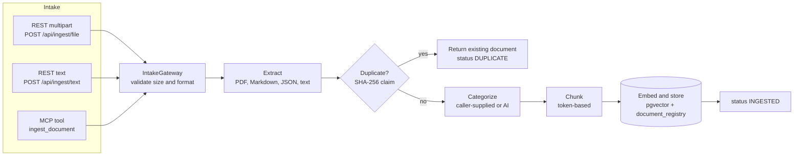
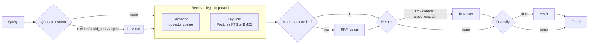
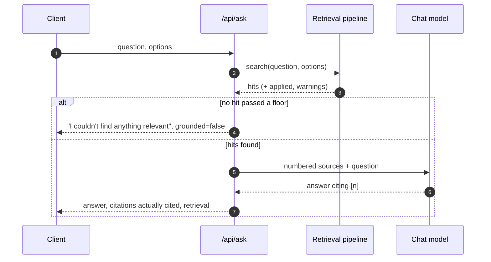
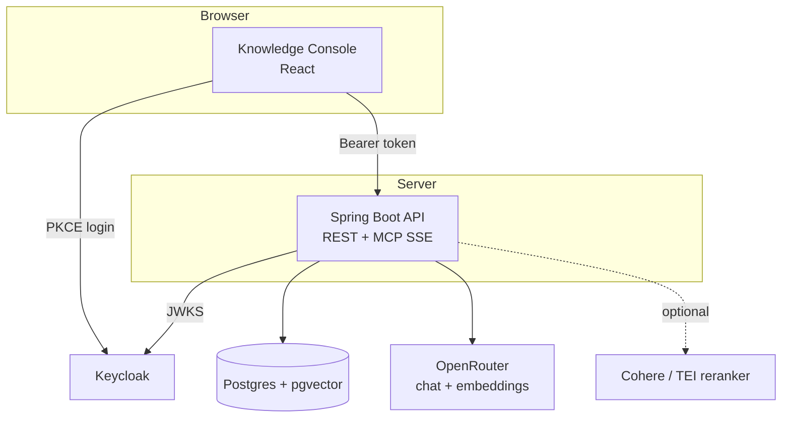

# Architecture diagrams

How a document gets in, how a question gets answered, and how callers are authenticated, as diagrams.
The full write-up is [Architecture](ARCHITECTURE.md); for endpoint details see the [API reference](api.md);
for retrieval options see the [retrieval toolkit](ARCHITECTURE.md#d-retrieval-toolkit).

## Ingestion pipeline

Every intake channel produces the same request; `IngestionPipeline` is the only class that knows the stage order.
Each stage sits behind an interface, so a strategy can be swapped without touching the others.



- **Duplicate check** claims the content hash before any model call, so concurrent uploads of the same file
  embed it once. Abandoned claims are swept after `ingestion.store.stale-after`.
- **Categorize** uses the caller's categories when given (first = primary); otherwise the chat model classifies
  an excerpt against the active category descriptions.

## Retrieval pipeline

The caller picks the techniques per request; configuration only sets defaults.
Optional stages degrade instead of failing: a skipped stage shows as `NONE` in `applied` with a warning.



Each leg applies its own relevance floor in its own score scale, and later stages only reorder survivors, so
an empty result always means "nothing relevant". See
[why scores are not comparable](ARCHITECTURE.md#why-scores-are-not-comparable-and-how-that-is-handled).

## Asking a question



## Authentication

The API is a stateless OAuth2 resource server. Browsers (the console) use Authorization Code with PKCE against
the public `generic-cli` client; tools such as curl use the password grant in development only.

```mermaid
sequenceDiagram
    participant U as Browser (console)
    participant K as Keycloak
    participant B as Spring Boot API
    U->>K: Authorization request + PKCE challenge
    K-->>U: Login page
    U->>K: Credentials
    K-->>U: Redirect with authorization code
    U->>K: Code + PKCE verifier
    K-->>U: Access token (aud generic-api, realm roles)
    U->>B: GET /api/search with Bearer token
    B->>B: Check issuer, audience, signature; map realm roles
    B-->>U: 200, or 401 / 403 as problem details
```

| Role | Grants |
|---|---|
| `kb-reader` | search, ask, MCP, list options, read these docs |
| `kb-editor` | `kb-reader` plus ingestion |
| `kb-admin` | `kb-editor` plus category administration and evaluation |

## Components


