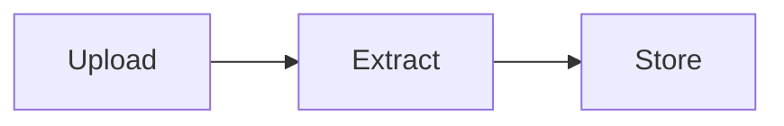

# Documentation viewer

The console (frontend) shows `README.md` and everything under `docs/` at `/#docs`, with navigation, search,
rendered Mermaid diagrams and a table of contents. The files in this repository are the only source: the Maven
build copies them onto the classpath (`docs-site/`), and the API serves that copy.

## Settings

| Property | Default | Meaning |
|---|---|---|
| `docs.enabled` | `true` (`false` in the `prod` profile) | Serve the docs at all. When `false`, `/api/docs/**` returns 404. |
| `docs.public` | `false` | `true` serves the docs without a token. When `false`, the `kb-reader` role is required, the same as search. |
| `docs.location` | `classpath:docs-site/` | Advanced: where the build put the docs. Read once at startup. |

Keep `docs.public=false`. The docs describe the security setup and list the development users and passwords,
which must not be readable anonymously. Production runs with `--spring.profiles.active=prod`, which turns the
viewer off entirely.

## Endpoints

| Endpoint | Returns |
|---|---|
| `GET /api/docs` | `home` (slug of the home page) and `pages`: the navigation tree of `title`, `slug`, `path`, `order`, `children` |
| `GET /api/docs/{slug}` | `slug`, `title`, `path`, `markdown`, `lastModified` |
| `GET /api/docs/assets/{path}` | an image referenced by one of the pages |

Responses carry `ETag`, `Last-Modified` and `Cache-Control: no-cache, private`, so clients revalidate cheaply
(`304 Not Modified`).

```bash
curl -s -H "Authorization: Bearer $TOKEN" localhost:8080/api/docs
curl -s -H "Authorization: Bearer $TOKEN" localhost:8080/api/docs/architecture
```

## Security model

- Everything is loaded once at startup. A request is a lookup in that set by slug; it is never turned into a
  file path, so `../`, encoded variants and unknown names get a plain 404 (or a 400 from the request firewall).
- Only `.md` files listed in the manifest (or found under the docs root when there is no manifest) are pages.
- Images are served only if a page references them, and only `png`, `jpg`, `jpeg`, `gif` and `webp`.
  SVG is excluded because it can carry scripts.
- The browser renders markdown as untrusted input: the HTML is sanitized with DOMPurify before it is inserted,
  and Mermaid runs with `securityLevel: strict`.

## Adding a page

1. Write the markdown file under `docs/` (subfolders are fine). Link to other pages with relative paths such
   as `[API reference](api.md#get-apisearch)`; headings get GitHub-style anchors.
2. Add it to `docs/_nav.json`:

   ```json
   { "file": "docs/runbook.md", "title": "Runbook" }
   ```

   `title` is optional (defaults to the first `#` heading) and so is `slug` (defaults to the path without
   `docs/` and `.md`, here `runbook`). Group pages with `{ "title": "Operations", "pages": [ ... ] }`.
3. Rebuild (`./mvnw process-resources` is enough while `spring-boot:run` is running, then restart) and run the
   tests: `DocsContentTests` fails on missing pages, broken relative links, unknown anchors and missing images.

Without `docs/_nav.json` the viewer lists `README.md` first and then every other markdown file alphabetically,
titled by its first heading.

### Diagrams

Fenced code blocks with the language `mermaid` render as diagrams and follow the console's light/dark theme:

````markdown

````

If a diagram doesn't parse, the viewer shows its source with the error and renders the rest of the page.
